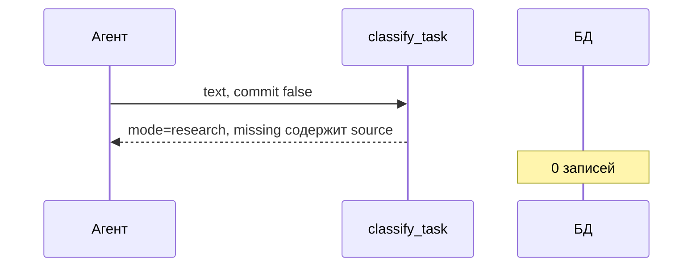
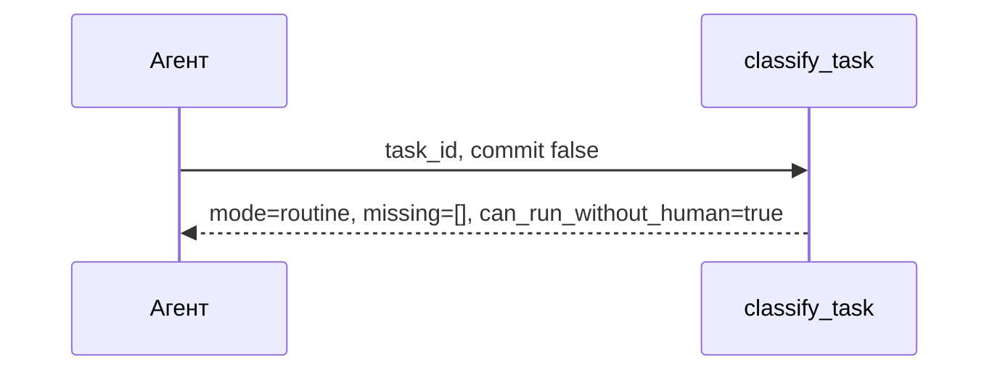
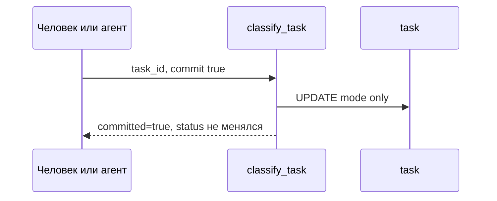
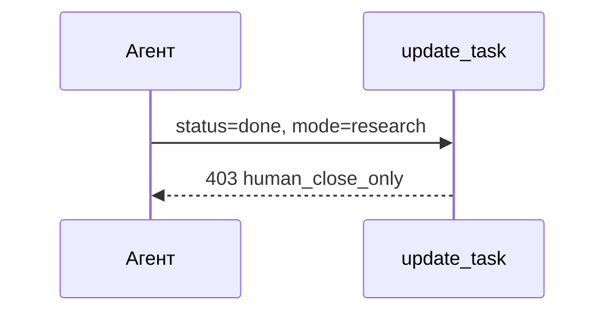
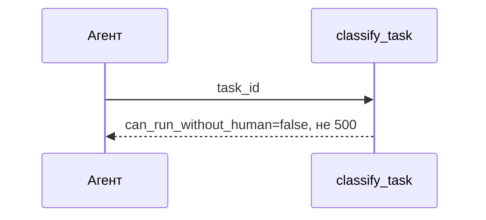

# Spec: классификатор `routine` vs `research` (`classify_task`)

- **ID:** 038-classify-task
- **Статус:** DRAFT
- **Дата:** 2026-11-18
- **Кастдев:** CD-10, 2026-11-18
- **ADR:** нет (модель `task.mode` — спека 036 у Dev; эта спека контракт классификатора)
- **Миграция:** нет (колонка не в этом срезе)
- **Связано:** CD-01/033 (`human_close_only`), CD-07 (evidence), CD-08 (слой знаний), CD-11 (`dod_required`), 020/032 (MCP), 035 (`commit`)

Источники требований: `docs/backlog.md` § CD-10; `Shared/GTrack-pilot/castdev-ya-analyst-2026-11-18.md`; правила сессии 6 (оркестратор, 2026-11-18). Требований вне этих текстов нет.

# Purpose

Аналитик работает через агента и хочет классификатор: «данных достаточно — делай без меня» (`routine`) vs research, который ведёт человек. Крупный запрос без источника, полноты и проверки валится; DoD машине не доверяют. Трекер хранит `task.mode` и отвечает MCP-инструментом `classify_task`, не запуская агента.

# Scope

**В рамках**

- Поле задачи `mode`: `routine` | `research`; значение по умолчанию `routine` (сессия 6).
- MCP `classify_task`: вход — задача и/или текст; выход — `mode`, список `missing`, флаг `can_run_without_human`.
- Без `commit` — 0 записей в БД. С `commit=true` пишется только `mode`, не `status=done`.
- Инвариант: research + агент `update_task`/`PATCH` в `done` → 403 `human_close_only` (уже CD-01/033).
- `can_run_without_human=true` только при пустом `missing`. Слой CD-08 может отсутствовать: флаг `false`, не 500.

**Вне рамок** (CD-10 «Вне рамок» + кастдев «не берём» + сессия 6)

- Раннер / харнесс агента; автозапуск агента без человека на research.
- Клон Viking, надстройка Яндекса, скилл конкурентной разведки, выкинуть веб-доску, личный vault как продукт.
- Код приложения, миграции, merge, деплой, прод в этом PR.
- Создание задачи, нарезка research и шаблон DoD — CD-11.
- Тип критерия `evidence` и закрытие по артефакту — CD-07.
- Запись в слой знаний — CD-08/CD-09.
- `propose_entities` — 035; этот срез его не меняет.

# Functional Requirements

- **FR-1 (поле `task.mode`):** У задачи есть `mode` ∈ {`routine`, `research`}. Ставит человек или классификатор (`docs/backlog.md` CD-10). Если значение не передано — `routine`. Физическая колонка не входит в этот PR: контракт колонки у Dev (спека 036).
- **FR-2 (MCP `classify_task`):** Инструмент записи (как `propose_entities`: без commit БД не меняет). Аргументы и ответ — § API ниже.
- **FR-3 (без commit):** `commit` отсутствует или `false` → ответ с `mode`, `missing`, `can_run_without_human`; **0** новых/изменённых строк в `task`, `comment`, `knowledge_record` и DoD/evidence.
- **FR-4 (commit):** `commit=true` при известном `task_id` обновляет только `task.mode`. Не меняет `status`, критерии DoD, evidence, знания. Событие аудита несёт `client_name` токена (ADR-0018), если колонка `mode` уже есть в схеме.
- **FR-5 (`missing`):** В ответе перечисляются отсутствующие поля из набора CD-10: источник, полнота, проверка, evidence. Коды: `source`, `completeness`, `verification`, `evidence`. Как именно поля читаются из задачи/текста — OI-1.
- **FR-6 (правило AC «конкурент»):** Текст/задача «сравни нас с конкурентом» без источников → `mode=research`, `missing` содержит как минимум `source`, в БД 0 строк (если `commit` не true либо `task_id` нет).
- **FR-7 (`routine` и исполнение):** Агент может исполнять `routine`, если обязательный DoD и обязательный evidence закрыты (CD-01/07) и есть попадание в слой знаний CD-08. Иначе `can_run_without_human=false`.
- **FR-8 (`can_run_without_human`):** `true` только если `missing` пуст **и** условия FR-7 выполнены. Если слой знаний CD-08 не развёрнут или вызов `list_knowledge` недоступен — флаг `false`, HTTP/MCP не 500.
- **FR-9 (`research`):** Агент не стартует research без DoD (CD-11). Ведёт человек по чек-листу. Этот срез не создаёт задачу research и не запускает агента.
- **FR-10 (`done`):** При `mode=research` агент не переводит задачу в `done`: 403 `human_close_only`. Поведение то же, что CD-01/033; классификатор не обходит флаг.
- **FR-11 (права):** Вызов с правами как у чтения задачи (`get_task`) для classify без commit; `commit=true` — как у `update_task`. Не-участник проекта — 403/404 как у `get_task`/`update_task` (020 FR-5). Токен `mcp:read` / `read_only`: `commit=true` запрещён (032).
- **FR-12 (`get_task`):** Когда колонка есть, `get_task` и REST карточки отдают `mode`. Этот PR UI не добавляет.

## API

MCP-инструмент `classify_task`. Транспорт — существующий `/mcp` (спека 020). Отдельного REST-пути этот срез не вводит. Черновик схемы — здесь, не в `docs/api/openapi.json` (генерация на main, конфликт).

Описание инструмента (лимит 100 символов, как 035 NFR-2): `Classify task routine vs research; commit writes mode only.`

```json
{
  "name": "classify_task",
  "inputSchema": {
    "type": "object",
    "properties": {
      "task_id": { "type": "string", "format": "uuid", "description": "Существующая задача" },
      "text": { "type": "string", "minLength": 1, "maxLength": 20000, "description": "Текст запроса, если задачи ещё нет. Потолок 20000 — как 035 `propose_entities`; в CD-10 длины нет (OI-2)" },
      "commit": { "type": "boolean", "default": false }
    }
  }
}
```

Хотя бы одно из `task_id`, `text` обязательно. Оба сразу: классифицируется текст на фоне полей задачи. Ни `task_id` ни `text` → 422 (OI-2, если формат кода ошибки нужно уточнить).

Успех:

```json
{
  "task_id": "uuid | null",
  "mode": "routine | research",
  "missing": ["source", "completeness", "verification", "evidence"],
  "can_run_without_human": false,
  "committed": false
}
```

`missing` — массив кодов; пустой массив, если пробелов нет. `committed=true` только если `commit=true` и `mode` записан. `task_id` в ответе = входной `task_id` или `null`, если классифицировали только текст.

Ошибки (существующие коды, не новые кроме явно названных в кастдеве):

| Условие | Код | Запись в БД |
|---|---|---|
| нет токена / битый токен | 401 (020) | 0 |
| нет доступа к задаче/проекту | 403/404 как `get_task` | 0 |
| `commit=true` на read-only токене | forbidden (032) | 0 |
| `commit=true` без `task_id` | 422 | 0 |
| `commit=true`, колонки `mode` нет | 503 или 422 — OI-3 | 0 |
| агент ставит `done` при research | 403 `human_close_only` | `status` не `done` |
| слой CD-08 отсутствует | не ошибка | 0; `can_run_without_human=false` |

`commit=true` **не** вызывает `create_task`. Создание research без DoD — CD-11 (`dod_required`), не этот инструмент.

# Non-functional Requirements

В CD-10 нет своих порогов latency, качества модели и аудита сверх MCP.

- **NFR-1 (изоляция):** запрос фильтруется по `workspace_id` токена (020 NFR-2).
- **NFR-2 (без исходящих):** этот срез не требует LLM и внешних вызовов на сервере. Алгоритм классификации в источниках не задан (OI-1).
- **NFR-3 (описание MCP):** строка описания инструмента ≤ 100 символов (035 NFR-2).
- **NFR-4 (этот PR):** только документы; 0 строк кода приложения, 0 миграций Alembic, 0 записей в БД пилота.
- **NFR-5 (совместимость):** `propose_entities` без `commit` по-прежнему 0 строк (CD-11 AC / 035 AC-1).

# Data Model

Колонка в этом PR не добавляется. Контракт поля:

| Поле | Тип | NULL | По умолчанию | Описание |
|---|---|---|---|---|
| `task.mode` | text | нет (после появления колонки) | `routine` | `CHECK` `mode IN ('routine','research')` |

Индекс не требуется источниками. Отдельной таблицы классификаций нет: `missing` и `can_run_without_human` в БД не хранятся, только в ответе `classify_task`.

Зависимости (чужие срезы, файлы не трогать):

- CD-01/033: критерии DoD, `human_close_only`.
- CD-07: обязательный evidence.
- CD-08: `knowledge_record`, `list_knowledge` — «попадание в слой»; если слоя нет, флаг false.
- Спека 036 (Dev): физическая колонка `task.mode`.

# Business Rules

- **BR-1:** Без `commit=true` классификатор ничего не пишет.
- **BR-2:** `commit=true` пишет только `mode`.
- **BR-3:** Default `mode=routine`.
- **BR-4:** `can_run_without_human=true` ⇔ `missing=[]` и закрыты обязательный DoD и обязательный evidence и есть попадание в слой знаний. Иначе `false`.
- **BR-5:** Нет слоя CD-08 → не 500, флаг `false`.
- **BR-6:** Research не закрывает агент (`human_close_only`).
- **BR-7:** Research без DoD не стартует агент (CD-11); этот инструмент задачу не создаёт.
- **BR-8:** DoD по-прежнему не доверяют машине: классификатор не отмечает критерии и не ставит `done`.
- **BR-9:** Человек может задать `mode` явно; конфликт явного `mode` на задаче и вывода классификатора — OI-4.

# User Flows

**UF-1.** Аналитик через агента: «сравни нас с конкурентом», источников нет.



**UF-2.** Рутина с закрытым DoD и evidence, слой знаний доступен и есть попадание.



**UF-3.** Запись режима.



**UF-4.** Агент закрывает research.



**UF-5.** Слоя CD-08 нет.



# Acceptance Criteria

Канон — «Готово, когда» CD-10 плюс правила сессии 6. Нумерация стабильна для тестов реализации (не этот PR).

- **AC-1** (бэклог): Given текст «сравни нас с конкурентом» без источников When `classify_task` (без `commit` или `commit=false`) Then `mode=research`, `missing` непустой (есть `source`), `count` строк `task` не меняется.
- **AC-2** (бэклог): Given задача, которую классификатор относит к `routine`, обязательный DoD и evidence закрыты, слой CD-08 доступен и есть попадание When `classify_task` Then `mode=routine`, `can_run_without_human=true`.
- **AC-3** (бэклог): Given `mode=research` When агент `update_task` / PATCH `status=done` Then 403 `human_close_only`, статус не `done`.
- **AC-4** (сессия 6): Given слой CD-08 не развёрнут When `classify_task` Then ответ 200 с `can_run_without_human=false`, не 500.
- **AC-5** (сессия 6): Given `commit` отсутствует или `false` When вызов Then 0 INSERT/UPDATE `task.mode` и прочих таблиц задач/знаний.
- **AC-6** (сессия 6): Given `commit=true` и существующий `task_id` When вызов Then изменился только `mode`; `status` не `done`; критерии и evidence не отмечены.
- **AC-7:** Given `commit=true` без `task_id` When вызов Then 422, в БД 0.
- **AC-8:** Given read-only MCP-токен When `commit=true` Then forbidden, `mode` не записан.
- **AC-9:** Given не-участник проекта When `classify_task` с чужим `task_id` Then 403/404 как у `get_task`.

# Open Issues

Неоднозначности источников. Реализацию этих пунктов не фиксировать без ответа владельца.

| # | Вопрос | Что есть в источниках | Чего нет |
|---|---|---|---|
| OI-1 | Алгоритм классификации | AC: нет источника → research; список пробелов: источник, полнота, проверка, evidence | Правила, LLM vs чек-лист, пороги, синонимы «сравни с конкурентом» |
| OI-2 | Обязательность `task_id`/`text` и код ошибки | «на вход задача/текст» | XOR vs OR; код 422 |
| OI-3 | `commit=true` до колонки 036 | колонка у Dev | 503 vs 422 vs no-op |
| OI-4 | Явный `mode` человека vs вывод классификатора | ставит человек или классификатор | кто побеждает при `commit` |
| OI-5 | Что такое «попадание в слой знаний» | FR routine требует попадание CD-08 | фильтр `list_knowledge`, пустой слой, чужой project-слой |
| OI-6 | Где лежат «источник / полнота / проверка» | CD-11: критерии DoD; CD-10: поля `missing` | отдельные колонки vs пункты DoD vs текст описания |
| OI-7 | REST/UI для `mode` | аналитик в UI не заходит | PATCH, фильтр доски, подпись в карточке |
| OI-8 | Default на уже существующих задачах | default routine для поля | backfill vs только новые |
| OI-9 | `can_run_without_human=true` при research | AC-2 только про routine | всегда false на research — не сказано явно |
| OI-10 | Аудит classify без commit | 035 пишет `client_name` при создании | нужен ли `domain_event` на сухой прогон |
| OI-11 | Имя кодов `missing` | русские слова в бэклоге | стабильные machine codes (`verification` vs `check`) |
| OI-12 | Связь с CD-11 | research без DoD не стартовать | должен ли `classify_task` возвращать `dod_required` |
